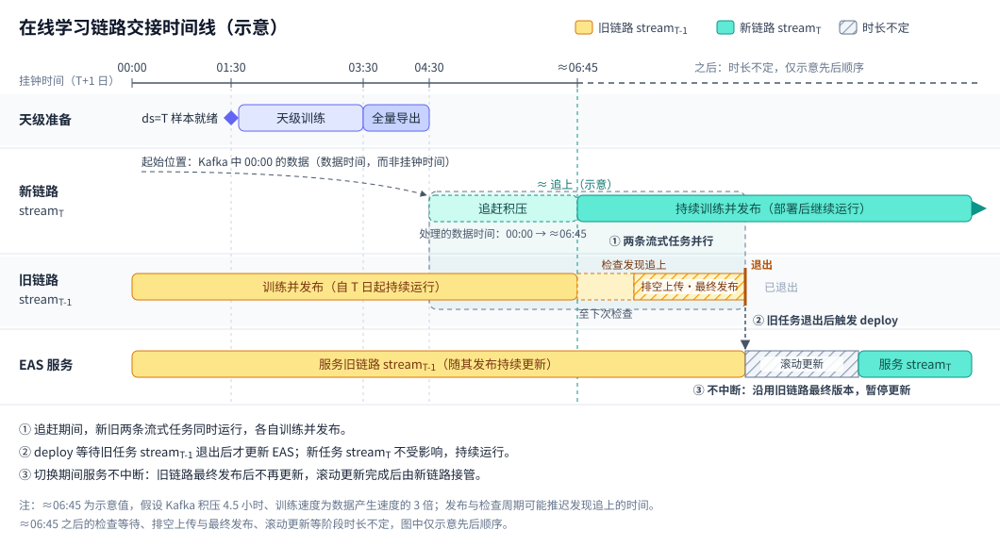

# 天级增量 + 流式训练的在线学习

本文介绍基于 TorchEasyRec，结合 [DataWorks](https://help.aliyun.com/zh/dataworks/product-overview/what-is-dataworks)、[PAI-DLC](https://help.aliyun.com/zh/pai/user-guide/what-is-dlc) 和 [PAI-EAS](https://help.aliyun.com/zh/pai/user-guide/eas-model-serving) 搭建在线学习链路的最佳实践：天级增量训练作为基线，每天基于天级模型启动一个流式训练任务；新的流式任务的消费进度接近旧任务后，旧任务自动退出，再由 DataWorks 把 EAS 服务切换到新任务的产出。

## 整体流程

以业务日期 T 为例：

1. 天级增量训练：从 T-1 的天级模型继续训练 MaxCompute 分区 `ds=T`，得到天级模型 T。
1. 全量导出：把天级模型 T 的 embedding 与 dense 参数导出到 OSS，作为 EAS 加载的初始模型，不上传 FeatureDB。
1. 流式训练 stream_T：从天级模型 T 出发，从 T+1 日 00:00 的 Kafka 位点开始消费，追赶到最新数据后持续训练，同时把增量 embedding 上传到 FeatureDB 版本 `ol_T`、发布 dense 模型。
1. 交接：stream\_{T-1} 每隔 `log_step_count_steps` 步比较两条链路 `model_dir` 下 `progress.json` 中已消费数据的事件时间，stream_T 落后不超过容忍值（默认 5 分钟，见 `ONLINE_LEARNING_HANDOVER_TOLERANCE_SECS`）时 stream\_{T-1} 跳过最终 checkpoint、完成最终发布后正常退出。
1. 切换：DataWorks 在 stream\_{T-1} 成功退出后，更新 EAS 服务到 stream_T。

同一时刻最多有两条"链路"（lineage）在运行：正在服务的 stream\_{T-1}，以及正在追赶的 stream_T。每天的链路切换同时起到了[全量再基线](../usage/export.md)的作用：只要天级任务按时成功，崩溃重启带来的 FeatureDB 漂移最多存在于一条链路（约一天）。

### 时间线示例

下图以业务日期 T 为例，横轴为 T+1 日的挂钟时间。假设天级样本 01:30 就绪、天级训练 03:30 完成、全量导出 04:30 完成；此时 stream_T 启动，但从 Kafka 中 00:00 的数据开始消费，即挂钟时间 04:30 时处理的是数据时间 00:00 的积压。图中约 06:45 处为示意的交接条件满足时刻，并非确切的交接时间。



追赶耗时约为 `积压时长 × 生产速度 / (训练速度 − 生产速度)`，上例中为 4.5 × 1 / (3 − 1) = 2.25 小时，即 04:30 启动后 135 分钟、约 06:45 完全追上。交接并不要求完全追上：交接条件比较的是两条链路 `progress.json` 中按 `save_checkpoints_timestamp_quorum` 汇总各 rank 后的已消费数据事件时间，stream_T 落后不超过容忍值（默认 300 秒）即可。

stream\_{T-1} 退出后 deploy 通过 EAS 滚动更新切换服务：旧实例保持 stream\_{T-1} 的最终版本，新实例逐步启动并加载 stream_T，期间 stream_T 持续训练与发布。

## 链路隔离

每条链路的可变资源都按业务日期区分，两条链路互不干扰：

| 资源                                     | 链路 T 的取值                        | 说明                                                                                        |
| ---------------------------------------- | ------------------------------------ | ------------------------------------------------------------------------------------------- |
| 流式任务 `model_dir`                     | `/mnt/data/online/stream/${T}/model` | checkpoint、Kafka 位点，以及交接判断使用的进度 `progress.json`                              |
| 模型导出目录 `ONLINE_DENSE_EXPORT_DIR`   | `/mnt/data/online/daily/${T}/export` | 天级模型 T 的全量导出目录，即 EAS 的模型目录；stream_T 也会在其中增量导出 dense 模型        |
| Kafka `group.id`                         | `tzrec_ol_${T}`                      | KafkaDataset 以消费组订阅 topic，两条链路共用一个 `group.id` 会互相 rebalance，**必须不同** |
| FeatureDB `feature_store_config.version` | `ol_${T}`                            | 包含 stream_T 的增量 embedding，不同链路的增量基于不同的天级模型，不能写入同一版本          |

## DataWorks 调度

在每个节点上配置调度参数（日调度时 `$[yyyymmdd]` 是业务日期的后一天）：

```
bizdate=$[yyyymmdd-1] prev=$[yyyymmdd-2] next=$[yyyymmdd] next_day=$[yyyy-mm-dd]
```

| 节点         | 节点类型 | 依赖                                                              | 作用                                       |
| ------------ | -------- | ----------------------------------------------------------------- | ------------------------------------------ |
| sample       | ODPS SQL | 上游样本表                                                        | 产出 `ds=${bizdate}` 样本分区              |
| train_daily  | PAI-DLC  | sample；**依赖上一周期（本节点）**                                | 天级增量训练                               |
| full_export  | PAI-DLC  | train_daily                                                       | 导出 embedding 与 dense 参数到 OSS         |
| train_stream | PAI-DLC  | full_export；**不依赖上一周期**，与前一天的 train_stream 并行运行 | 流式训练，下一条链路满足交接条件后自动退出 |
| deploy       | PyODPS 3 | full_export；**依赖上一周期（本节点 + train_stream 节点）**       | 前一天的 train_stream 退出后切换 EAS       |

### train_daily

```bash
dlc submit pytorchjob \
    --name=online_train_daily_${bizdate} \
    --command='set -e
        pip install tzrec[cu130]==${TZREC_NIGHTLY_VERSION} -f http://tzrec.oss-accelerate.aliyuncs.com/release/nightly/repo.html --trusted-host tzrec.oss-accelerate.aliyuncs.com
        ODPS_ENDPOINT=http://service.<region>.maxcompute.aliyun-inc.com/api \
        torchrun --master_addr=$MASTER_ADDR --master_port=$MASTER_PORT \
            --nnodes=$WORLD_SIZE --nproc-per-node=$NPROC_PER_NODE --node_rank=$RANK \
            -m tzrec.train_eval \
            --pipeline_config_path /mnt/data/online/daily.config \
            --model_dir /mnt/data/online/daily/${bizdate} \
            --fine_tune_checkpoint /mnt/data/online/daily/${prev} \
            --train_input_path odps://<project>/tables/<sample_table>/ds=${bizdate}
        ' \
    --data_sources=<OSS 数据集 ID> \
    --workspace_id=<工作空间 ID> \
    --priority=1 \
    --job_max_running_time_minutes=1440 \
    --workers=<节点数> \
    --worker_image=dsw-registry-vpc.<region>.cr.aliyuncs.com/pai/torcheasyrec:1.5.0-pytorch2.14.0-gpu-py311-cu130-ubuntu22.04 \
    --driver=580.126.09 \
    --worker_spec=<GPU 机型> \
    --enable_credential=true \
    --disable_ecs_stock_check=true
```

### full_export

将天级模型的 embedding 与 dense 参数全量导出到 OSS，作为 EAS 服务的模型目录。天级配置中不配置 `export_config.dynamic_embedding.feature_store_config`，导出时只生成导出文件，不上传 FeatureDB，详见[dynemb 流式导出与 FeatureDB 全量上传](../usage/export.md)：

```bash
dlc submit pytorchjob \
    --name=online_full_export_${bizdate} \
    --command='set -e
        pip install tzrec[cu130]==${TZREC_NIGHTLY_VERSION} -f http://tzrec.oss-accelerate.aliyuncs.com/release/nightly/repo.html --trusted-host tzrec.oss-accelerate.aliyuncs.com
        ODPS_ENDPOINT=http://service.<region>.maxcompute.aliyun-inc.com/api \
        USE_DISTRIBUTED_EMBEDDING=1 \
        torchrun --master_addr=$MASTER_ADDR --master_port=$MASTER_PORT \
            --nnodes=$WORLD_SIZE --nproc-per-node=$NPROC_PER_NODE --node_rank=$RANK \
            -m tzrec.export \
            --pipeline_config_path /mnt/data/online/daily/${bizdate}/pipeline.config \
            --export_dir /mnt/data/online/daily/${bizdate}/export
        ' \
    --data_sources=<OSS 数据集 ID> \
    --workspace_id=<工作空间 ID> \
    --priority=1 \
    --job_max_running_time_minutes=1440 \
    --workers=<节点数> \
    --worker_image=dsw-registry-vpc.<region>.cr.aliyuncs.com/pai/torcheasyrec:1.5.0-pytorch2.14.0-gpu-py311-cu130-ubuntu22.04 \
    --driver=580.126.09 \
    --worker_spec=<GPU 机型> \
    --enable_credential=true \
    --disable_ecs_stock_check=true
```

### train_stream

流式训练配置（只列出与在线学习相关的部分）：

```
train_config {
    num_epochs: 1
    save_checkpoints_timestamp_interval: 3600
    keep_checkpoint_max: 3
    delta_embedding_dump_config {
        paired_dump_interval_minutes: 10
        feature_store_config {
            region: "cn-beijing"
            project_name: "recommendation"
            feature_view_name: "model_embeddings"
            # version 不写，由启动命令的 --edit_config_json 按链路指定
        }
    }
    ...
}
data_config {
    dataset_type: KafkaDataset
    ...
}
```

- 使用 `num_epochs: 1`，**不要设置 `num_steps`**：Kafka 数据流不会结束，任务只会因交接而正常退出；train_stream 正常退出会直接触发下一天的 deploy，deploy 不再重复判断交接条件。
- 学习率建议使用常数学习率；从天级模型 fine-tune 时不会恢复学习率调度进度。

```bash
dlc submit pytorchjob \
    --name=online_train_stream_${bizdate} \
    --command='set -e
        pip install tzrec[cu130]==${TZREC_NIGHTLY_VERSION} -f http://tzrec.oss-accelerate.aliyuncs.com/release/nightly/repo.html --trusted-host tzrec.oss-accelerate.aliyuncs.com
        START_MS=$(( $(date -d "${next_day} 00:00:00 +0800" +%s) * 1000 ))
        USE_DISTRIBUTED_EMBEDDING=1 \
        ONLINE_DENSE_EXPORT=1 \
        ONLINE_DENSE_EXPORT_DIR=/mnt/data/online/daily/${bizdate}/export \
        ONLINE_LEARNING_SUCCESSOR_DIR=/mnt/data/online/stream/${next}/model \
        FEATUREDB_USERNAME=<FeatureDB 用户名> FEATUREDB_PASSWORD=<FeatureDB 密码> \
        torchrun --master_addr=$MASTER_ADDR --master_port=$MASTER_PORT \
            --nnodes=$WORLD_SIZE --nproc-per-node=$NPROC_PER_NODE --node_rank=$RANK \
            -m tzrec.train_eval \
            --pipeline_config_path /mnt/data/online/stream.config \
            --continue_train \
            --fine_tune_checkpoint /mnt/data/online/daily/${bizdate} \
            --model_dir /mnt/data/online/stream/${bizdate}/model \
            --train_input_path "kafka://<broker>/<topic>?group.id=tzrec_ol_${bizdate}&start.timestamp.ms=$START_MS" \
            --edit_config_json "{\"train_config.delta_embedding_dump_config.feature_store_config.version\":\"ol_${bizdate}\"}"
        ' \
    --data_sources=<OSS 数据集 ID> \
    --workspace_id=<工作空间 ID> \
    --priority=1 \
    --job_max_running_time_minutes=4320 \
    --workers=<节点数> \
    --worker_image=dsw-registry-vpc.<region>.cr.aliyuncs.com/pai/torcheasyrec:1.5.0-pytorch2.14.0-gpu-py311-cu130-ubuntu22.04 \
    --driver=580.126.09 \
    --worker_spec=<GPU 机型> \
    --enable_credential=true \
    --disable_ecs_stock_check=true
```

首次启动与失败重启使用同一条命令：

- 首次启动时 `model_dir` 中没有 checkpoint，从天级模型加载参数；天级 checkpoint 中没有 Kafka 位点，因此按 `start.timestamp.ms` 开始消费。
- 失败重启时 `model_dir` 中已有 checkpoint，优先从中恢复参数和 Kafka 位点，`--fine_tune_checkpoint` 不再生效。

### deploy

deploy 使用 PyODPS 3 节点，调度资源组选择 `dataworks_pairec_task_pod`（其中预置了 `eascmd64`），调度参数同上，节点内通过 `args` 读取。

```python
import json
import subprocess

from odps.accounts import StsAccount

service_name = "<EAS 服务名>"
bizdate = args["bizdate"]

sts_token = o.account.sts_token if isinstance(o.account, StsAccount) else None

config = {
    "name": service_name,
    "cloud": {"computing": {"instances": [{"type": "<机型>"}]}},
    "storage": [
        {
            "mount_path": "/home/admin/docker_ml/workspace/model/",
            "oss": {
                "path": f"oss://<bucket>/online/daily/{bizdate}/export/",
                "readOnly": False,
            },
            "properties": {"resource_type": "code"},
        },
    ],
    "model_config": {
        "outputs": "<输出名，逗号分隔>",
        "fg_mode": "normal",
        "region": "<region>",
        "access_key_id": o.account.access_id,
        "access_key_secret": o.account.secret_access_key,
        "security_token": sts_token,
        "fs_project": "<FeatureStore 项目>",
        "fs_model": "<FeatureStore 模型特征>",
        "fs_entity": "<FeatureStore 实体>",
        "featuredb_username": "<FeatureDB 用户名>",
        "featuredb_password": "<FeatureDB 密码>",
        "feature_store_embedding_polling": {
            "feature_view_name": "<与训练 feature_store_config 相同的 feature_view_name>",
            "version": f"ol_{bizdate}",
        },
        "dense_hot_load": {
            "enable": True,
            "dense_poll_interval_minutes": 1,
        },
    },
    "processor": "easyrec-torch-<版本>",
}

with open("service.json", "w") as f:
    json.dump(config, f)

cmd = [
    "/home/admin/usertools/tools/eascmd64",
    "-i",
    o.account.access_id,
    "-k",
    o.account.secret_access_key,
    "-e",
    "pai-eas-manage-vpc.<region>.aliyuncs.com",
]
if sts_token:
    cmd += ["-t", sts_token]
subprocess.run(cmd + ["modify", service_name, "-s", "service.json"], check=True)
```

在线学习相关的 Processor 参数：

- `feature_store_embedding_polling`：从 FeatureDB 轮询增量 embedding 的配置。必填项为 `feature_view_name` 和 `version`，且需与训练时写入的 FeatureView 和版本一致；选填 `sparse_poll_interval_secs`，默认 0，见下条。
- `sparse_poll_interval_secs`（位于 `feature_store_embedding_polling` 内）：默认 0，即不做独立的周期扫描，只在加载新的 dense 版本时同时拉取一次增量 embedding，拉取频率由 `dense_hot_load.dense_poll_interval_minutes` 控制；设为正数（秒）时按该间隔独立、更高频地拉取增量 embedding，使其更快生效。
- `dense_hot_load`：`enable` 为 `true` 时每隔 `dense_poll_interval_minutes` 分钟（默认 1）轮询模型目录下的 `dense_hot_export/current.json`。

此外，全量导出与流式训练的产物需要相互兼容：

- 两者需使用相同的模型配置。
- full_export 的 `DIST_QUANT` 需与 train_stream 中 `delta_embedding_dump_config.quant_type` 一致（同为 INT8 或同为不量化），FeatureView 的元素类型需与模型一致。

`model_config` 中其余参数见[模型服务](../usage/serving.md)，与线上服务保持一致即可。EAS 会滚动更新实例，滚动更新进度可在 EAS 控制台查看。

## 运维建议

- Kafka 保留时长 ≥ 天级样本延迟 + 天级训练与导出耗时 + 追赶耗时 + 一天的重跑余量。
- Kafka 分区数需是 `nproc-per-node * nnodes * num_workers` 的倍数。
- 下一条链路迟迟追不上时（天级任务失败、追赶太慢），stream\_{T-1} 会继续训练并服务，但受 train_stream 节点超时、DLC 最长运行时长与 FeatureDB 视图 TTL 的限制，需配置告警及时处理。

| 故障                      | 影响                                            | 处理                                       |
| ------------------------- | ----------------------------------------------- | ------------------------------------------ |
| 天级训练或导出失败        | stream_T 不启动，stream\_{T-1} 继续服务         | 修复后重跑节点，下游自动继续               |
| train_stream 任务异常退出 | DLC 自动重启，从 `model_dir` 的 checkpoint 恢复 | 重启失败时重跑 train_stream 节点，命令不变 |
| EAS 滚动更新失败          | EAS 保持原链路                                  | 排查 Processor 日志后重跑 deploy 节点      |
