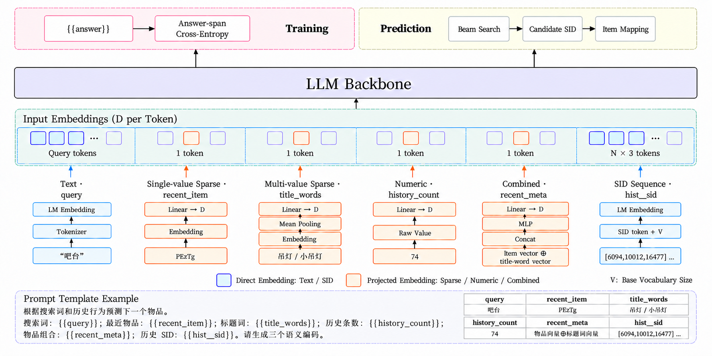

# GenRec

## 简介

GenRec 是以大语言模型（LLM）为底座的生成式召回模型。它将用户画像、SID、行为历史序列和文本等特征按 Prompt 模板组合，使用自回归模型直接生成下一个物品的语义 ID（Semantic ID，简称 SID），再通过 SID 到物品的映射表得到召回结果。



当前模型配置为 `genrec_causal_lm_model`，骨干模型使用 `hf_model_name_or_path` 指定，支持 Qwen2.5/3 等 Decoder-Only 模型。 物品 SID 可以由 [SID RQVAE](sid_rqvae.md) 或 [SID RQKMeans](sid_rqkmeans.md) 生成。

GenRec 将 `prompt_config` 用于模板、槽位和 SID 空间配置，`model_config` 用于 LM 参数和解码参数。

## 配置说明

下面展示文本、单值及多值稀疏、数值、历史 SID 与标签序列、多特征组合的关键配置，字段与样本说明见<a href="#genrec-sample-data">数据说明</a>。

```
feature_configs {
    tokenize_feature {
        feature_name: "query"
        expression: "user:query"
        tokens_as_sequence: true
        sequence_length: 32
    }
}
feature_configs {
    id_feature {
        feature_name: "recent_item"
        expression: "user:recent_item_id"
        hash_bucket_size: 16384
        embedding_dim: 16
    }
}
feature_configs {
    id_feature {
        feature_name: "title_words"
        expression: "user:recent_title_words"
        hash_bucket_size: 8192
        embedding_dim: 16
        value_dim: 0
        pooling: "mean"
    }
}
feature_configs {
    raw_feature {
        feature_name: "history_count"
        expression: "user:history_count"
        value_dim: 1
    }
}
feature_configs {
    sequence_feature {
        sequence_name: "hist"
        sequence_length: 50
        sequence_delim: ";"
        features {
            id_feature {
                feature_name: "sid"
                expression: "item:sid_codes"
                value_dim: 3
                num_buckets: 24576
            }
        }
        features {
            id_feature {
                feature_name: "tag"
                expression: "item:tag_ids"
                embedding_dim: 32
                hash_bucket_size: 10000
                value_dim: 0
                pooling: "mean"
                default_value: "__missing_tag__"
            }
        }
    }
}
prompt_config {
    tokenizer_path: "data/genrec/backbone/tokenizer.json"
    prompt: "根据搜索词和历史行为预测下一个物品。\n搜索词：{{query}}；最近物品：{{recent_item}}；标题词：{{title_words}}；历史条数：{{history_count}}；\n物品组合：{{recent_meta}}；历史 SID：{{hist__sid}}；对应的历史物品标签：{{history_tags}}。请生成三个语义编码。"
    response: "{{answer}}"
    slots {
        name: "recent_meta"
        feature_names: "recent_item"
        feature_names: "title_words"
        projection {
            mlp { hidden_units: 64 }
        }
    }
    slots {
        name: "history_tags"
        feature_names: "hist__tag"
        projection {
            mlp { hidden_units: 128 }
            bias: true
        }
    }
    sid_space {
        codebook: 8192
        codebook: 8192
        codebook: 8192
    }
    max_length: 512
}
model_config {
    genrec_causal_lm_model {
        hf_model_name_or_path: "Qwen/Qwen2.5-0.5B"
        common {
            lm_parameter_dtype: FP32
            attn_kernel: "sdpa"
            beam_widths: 10
            beam_widths: 20
            beam_widths: 50
            num_return_sequences: 5
        }
    }
}
```

### prompt_config

| 参数                      | 说明                                                                                                       |
| ------------------------- | ---------------------------------------------------------------------------------------------------------- |
| `tokenizer_path`          | 必填，基础 tokenizer JSON 文件的本地路径。使用未扩展 SID token 的词表，并与骨干模型对应                    |
| `prompt`                  | 必填，输入模板，使用 `{{name}}` 引用特征或槽位；需要的提示文本直接写入模板                                 |
| `response`                | 必填，监督目标模板，示例为 `{{answer}}`，其中的占位符引用 `data_config.label_fields`；预测时也必须保留配置 |
| `slots`                   | 可选，配置模板中槽位的名称、所引用的特征及投影方式                                                         |
| `sid_space.codebook`      | 必填，每层的码本大小，各项必须为正数；列表长度决定生成 SID 的层数                                          |
| `sid_space.token_format`  | 可选，SID token 的文本格式，默认 `<\|sid_{i}\|>`，必须包含 `{i}`；`i` 是按层偏移后的编码                   |
| `sid_space.manifest_path` | 可选，SID 冲突后处理产出的 manifest JSON 文件本地路径，其中的码本大小须与 `sid_space.codebook` 一致        |
| `max_length`              | 可选，配置校验时的总长度上限，默认 `0`。计算范围包含 Prompt 和 response；不用于自动截断输入                |

`sid_space.codebook` 应与生成样本 SID 时使用的各层码本大小一致；使用冲突后处理结果时，应与工具的 `--codebook` 一致。

#### 模板与槽位

直接引用单个特征时，可在模板中使用其特征名，例如 `{{hist__sid}}`。组合多个特征或配置投影时，在 `slots` 中声明，例如上面的 `{{recent_meta}}`。`slots.name` 须与模板中的占位符一致，声明的槽位必须在模板中使用。

#### 特征填充方式

填充方式由特征配置自动确定，无需单独指定：

- **INLINE**：将 SID 或文本分词 ID 直接填入 Prompt。单个序列特征的 `id_feature`、`tokenize_feature` 省略 `embedding_dim` 时使用此方式，不配置 `projection`。
- **PROJECTED**：用于需要 embedding 或数值处理的特征。可通过 `projection.mlp.hidden_units` 配置 MLP；省略 `projection` 时使用默认的线性投影。

本例的 `query` 和 `hist__sid` 使用 INLINE，SID 的 `value_dim: 3` 表示三层编码。`recent_item`、`title_words` 和 `history_count` 使用 PROJECTED；`title_words` 通过 `pooling: "mean"` 聚合多个标题词，`value_dim: 0` 允许词数不同。组合槽位 `recent_meta` 复用 `recent_item` 和 `title_words`，通过 `projection.mlp.hidden_units` 配置投影。

`hist__tag` 保留每个历史物品的标签，经 `pooling: "mean"` 聚合后，使用 `history_tags` 槽位逐项投影；SID 与 tag 历史须逐项对应且长度一致。

同一槽位组合多个特征时，成员必须同为标量或同为序列；序列须逐项对应且长度一致。

`response` 指定监督目标；预测时仅使用 Prompt 中的输入特征。本例中的最近物品及其标题词均来自保留的历史行为。

#### 长度配置

通过 `sequence_length` 设置历史序列长度，SID 特征的 `value_dim` 须与码本层数一致。`max_length` 在配置校验时检查 Prompt 和目标 SID 的长度上限，不会自动截断输入。

### genrec_causal_lm_model

| 参数                          | 说明                                                                                                           |
| ----------------------------- | -------------------------------------------------------------------------------------------------------------- |
| `hf_model_name_or_path`       | 可选，预训练骨干模型的 HuggingFace 模型 ID 或本地目录，默认 `Qwen/Qwen2.5-0.5B`                                |
| `common.lm_parameter_dtype`   | 可选，LM 参数精度，`FP32`、`BF16` 或 `FP16`，默认 `FP32`；计算的混合精度由 `train_config.mixed_precision` 控制 |
| `common.attn_kernel`          | 可选，注意力计算方式，默认 `"sdpa"`，也可使用 `"flash_attention_2"`                                            |
| `common.beam_widths`          | 必填，每层一个 beam 宽度，长度必须等于码本层数，且每项至少为 `1`；可使用固定宽度或逐层递增宽度                 |
| `common.num_return_sequences` | 必填，返回的 SID 数量，至少为 `1`，不得超过最后一层实际可保留的 beam 数                                        |
| `common.generated_sids_key`   | 可选，预测输出列名，默认 `"generated_sids"`                                                                    |

`hf_model_name_or_path` 指定模型 ID 时，所需配置和预训练权重会自动下载并缓存。

示例使用 FP32 参数，并通过 `train_config.mixed_precision: "BF16"` 开启混合精度计算。使用 `flash_attention_2` 时，需要 NVIDIA GPU、与项目环境匹配的 FlashAttention 依赖，并将混合精度设置为 BF16 或 FP16。

模型自动计算交叉熵损失 `ce_loss`，并在评估时输出同名指标，无需额外声明 `model_config.losses` 或 `metrics`。召回的 HitRate、Recall 等指标需将预测 SID 映射为物品后，与真实物品另行计算。

## 模型输出

默认输出列 `generated_sids` 的每行形状为 `(num_return_sequences, 码本层数)`，各 SID 按预测得分从高到低排列。例如 `[[3, 5, 7], [8, 4, 12], ...]`。**输出是每层从 0 开始的编码**，应与最终 SID 映射表的 `codebook` 列对齐；若使用 `offset_codebook` 做关联，需先加回层偏移。

生成 SID 的层数与码本层数一致。召回时需查询 SID 到物品的映射表，过滤没有对应物品的 SID，并展开同一 SID 对应的物品列表。

## 运行示例

环境准备与启动方式请参考 [Local Tutorial](../quick_start/local_tutorial.md) 和 [DLC Tutorial](../quick_start/dlc_tutorial.md)；训练、评估、离线预测和模型导出流程分别参见 [训练](../usage/train.md)、[评估](../usage/eval.md)、[Checkpoint 预测](../usage/predict.md) 和 [导出](../usage/export.md)。

完整示例配置：[genrec.config](https://tzrec.oss-cn-beijing.aliyuncs.com/config/models/genrec.config)。

<a id="genrec-sample-data"></a>

### 数据说明

#### SID 编码

使用 [SID 冲突后处理工具](../usage/sid_collision.md) 生成物品 SID 后，按 `item_id` 关联同一代结果中的 `item_to_sid` 产物，直接使用 **`offset_codebook` 列**构建 GenRec 样本：

- 历史物品：按行为序列的顺序组合各物品的 `offset_codebook`，作为历史 SID 序列输入。
- 目标物品：使用目标物品的 `offset_codebook` 作为标签。

样本直接使用 `offset_codebook`，**无需再次添加层偏移或 LM 词表偏移**。

物品映射、历史、标签和可选的 SID manifest 应来自同一代后处理结果。

#### 示例数据

示例数据来自 [FORGE](https://github.com/selous123/al_sid) 开源数据集，抽样并整理为 Parquet 格式：

- 训练数据：[genrec_train.parquet](https://tzrec.oss-cn-beijing.aliyuncs.com/data/models/genrec_train.parquet)（1800 行）。
- 评估数据：[genrec_eval.parquet](https://tzrec.oss-cn-beijing.aliyuncs.com/data/models/genrec_eval.parquet)（200 行）。

训练和评估文件的字段如下：

| 列名                 | 类型                   | 说明                                      |
| -------------------- | ---------------------- | ----------------------------------------- |
| `sample_id`          | string                 | 样本标识，不作为模型输入                  |
| `query`              | string                 | 搜索词                                    |
| `recent_item_id`     | string                 | 最近一条保留历史行为的物品 ID             |
| `recent_title_words` | array\<string>         | 最近保留物品的标题词列表                  |
| `history_count`      | int64                  | 过滤和截断之前的原始历史行为条数          |
| `hist__sid_codes`    | array\<array\<int64>>  | 历史物品的 `offset_codebook` 序列         |
| `hist__tag_ids`      | array\<array\<string>> | 与 SID 历史逐项对应的物品脱敏 tag ID 列表 |
| `answer`             | array\<int64>          | 目标物品的 `offset_codebook`              |

示例使用三层码本 `[8192, 8192, 8192]`，保留有 SID 映射的最近最多 50 条历史行为，并同步保留对应的 tag。`history_count` 记录原始历史长度，可能大于保留的历史条数。组合槽位 `recent_meta` 由特征配置生成，无需在数据中增加同名列。

训练和评估样本分别抽取自 FORGE 的公开搜索行为训练集和测试集，用于演示配置和运行流程。

常见问题请参见 [FAQ](../faq.md)。
